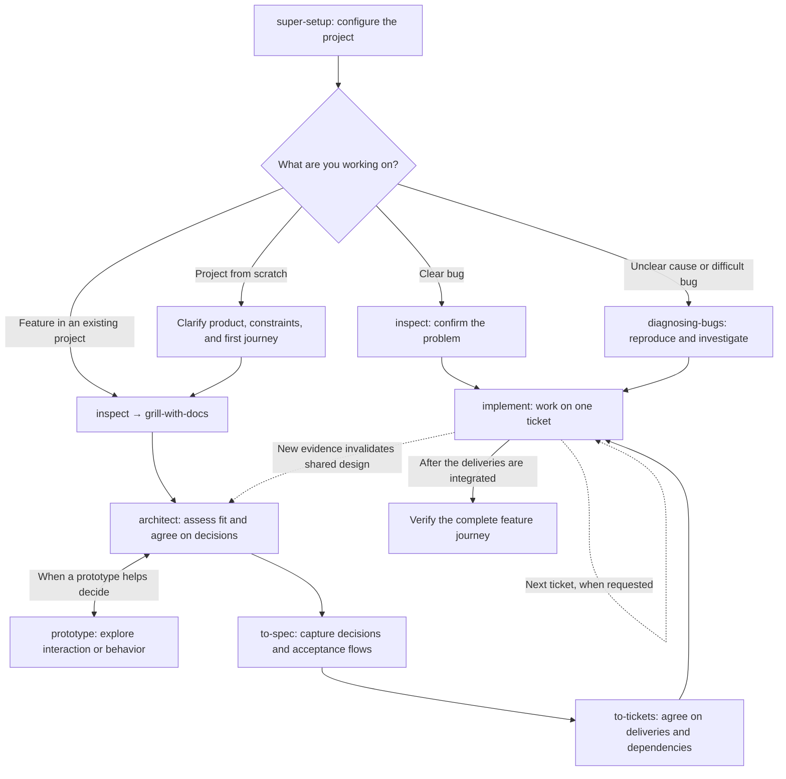

# Esquils

An experimental collection of skills for AI coding agents. “Esquils” is a playful Spanish take on “skills.” It builds on Matt Pocock's skills and takes inspiration from the TaeControl methodology by [guetteman](https://github.com/guetteman).

The goal is a more consistent workflow connecting product decisions, design, implementation, and verification. **All skills, including imported ones, are subject to changes and modifications.**

## Install globally

```bash
npx skills add rondevz/esquils -g --skill '*' --agent claude-code codex opencode
```

This installs the full catalog for the three agents. Use `--list` to browse it or `--skill <name>` to choose specific skills. External tools such as Manuvra require separate setup.

## Develop locally

```bash
git clone https://github.com/rondevz/esquils.git ~/code/esquils
cd ~/code/esquils
python3 scripts/link-global-skills.py
```

The script links this checkout directly for the three agents, preserving existing entries. Use this mode to iterate without reinstalling; rerun it when adding skills. Open a new agent session if changes haven't appeared.

## Workflow

Run [super-setup](skills/super-setup/SKILL.md) once in the target project, then choose the route that fits your work. This is a guided workflow: invoke the next skill when ready. It does not automatically execute the whole backlog.



### Choose your starting point

- **Bug:** establish the failing behavior and expected result. Use `inspect` for a clear fix, or `diagnosing-bugs` when the cause needs investigation. Continue with `implement`, carrying forward any reproduction, tests, or fix already produced by diagnosis. A bounded fix does not need a new spec and ticket breakdown unless its scope expands.
- **Existing feature:** use `inspect` and `grill-with-docs` to establish facts, scope, and constraints. `architect` recommends how the change fits the system; iterate with `prototype` when needed. Agree on the solution, then run `to-spec` and `to-tickets`.
- **New project:** first clarify the product and shared technology, design, and architecture choices. Inspection covers whatever scaffolding exists; an empty repository has no established patterns to reuse. Make the first ticket a small complete journey that validates the shared foundation, review it, then build the remaining tickets against that reference.

### Work through the tickets

Call [implement](skills/engineering/implement/SKILL.md) with the ticket reference. It runs this sequence internally:

**explorer → resolve blocking questions → TDD → checks and agreed acceptance flows → code-review → record evidence → commit and push.**

You agree on observable success before implementation: starting state, actions, and expected results. The agent gathers code context through [explorer](skills/explorer/SKILL.md), follows accepted decisions, and verifies those results. Use the project's selected tools; [Manuvra](skills/manuvra/SKILL.md) is an optional browser-journey executor with separate runtime setup.

Work one ticket at a time for the first trial. If implementation invalidates a shared decision, return that question to `architect` and update affected plans. After integration, verify the complete journey across tickets and views. A push alone does not establish integration, and missing or failing required checks leave delivery unverified.

Browse the [skills](skills/) for details. Browser execution and readiness skills live in [web](skills/web/README.md). Source revisions, licenses, and local adaptations are recorded in [UPSTREAM.md](UPSTREAM.md).

## Inspiration and references

- [Matt Pocock's skills](https://github.com/mattpocock/skills)
- [TaeControl's skills](https://github.com/taecontrol/skills), by [guetteman](https://github.com/guetteman)
- [Manuvra](https://github.com/taecontrol/manuvra)
