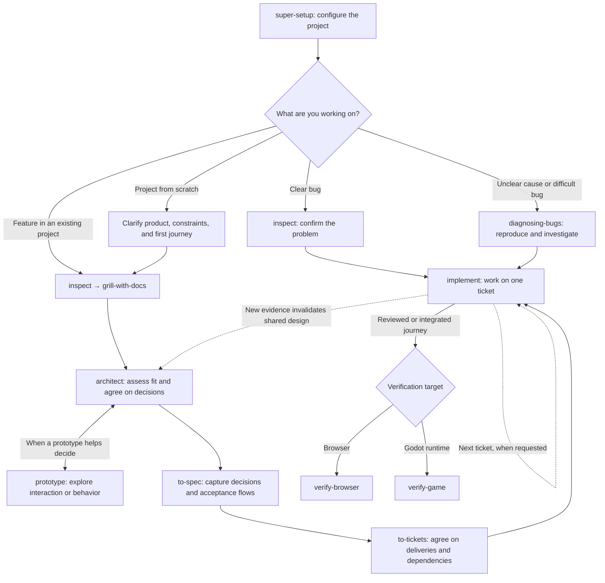

# Esquils

**Version [0.0.1](https://github.com/rondevz/esquils/releases/tag/v0.0.1)** — initial experimental release.

An experimental collection of skills for AI coding agents. “Esquils” is a playful Spanish take on “skills.” It builds on Matt Pocock's skills and takes inspiration from the TaeControl methodology by [guetteman](https://github.com/guetteman).

The goal is a more consistent workflow connecting product decisions, design, implementation, and verification. **All skills, including imported ones, are subject to changes and modifications.**

## Install globally

```bash
npx skills add rondevz/esquils -g --skill '*' --agent claude-code codex opencode
```

This installs the full catalog for the three agents. Use `--list` to browse it or `--skill <name>` to choose specific skills. External tools such as Manuvra require separate setup.

## Develop locally

```bash
git clone https://github.com/rondevz/esquils.git ~/code/esquils
cd ~/code/esquils
python3 scripts/link-global-skills.py
```

The script links this checkout directly for the three agents, preserving existing entries. Use this mode to iterate without reinstalling; rerun it when adding skills. Open a new agent session if changes haven't appeared.

## Workflow

Run [super-setup](skills/super-setup/SKILL.md) once in the target project, then choose the route that fits your work. This is a guided workflow: invoke the next skill when ready. It does not automatically execute the whole backlog. For Godot gameplay experiments, assets and runtime verification, follow the [game development guide](skills/game/README.md); browser workflows keep the [web profile](skills/web/README.md).



### Choose your starting point

- **Bug:** establish the failing behavior and expected result. Use `inspect` for a clear fix, or `diagnosing-bugs` when the cause needs investigation. Continue with `implement`, carrying forward any reproduction, tests, or fix already produced by diagnosis. A bounded fix does not need a new spec and ticket breakdown unless its scope expands.
- **Existing feature:** use `inspect` and `grill-with-docs` to establish facts, scope, and constraints. `architect` recommends how the change fits the system; iterate with `prototype` when needed. Agree on the solution, then run `to-spec` and `to-tickets`.
- **New project:** first clarify the product and shared technology, design, and architecture choices. Inspection covers whatever scaffolding exists; an empty repository has no established patterns to reuse. Make the first ticket a small complete journey that validates the shared foundation, review it, then build the remaining tickets against that reference.

### Work through the tickets

Call [implement](skills/engineering/implement/SKILL.md) with the ticket reference. It runs this sequence internally:

**explorer → resolve blocking questions → applicable tests/TDD → checks and agreed acceptance flows → code-review → record evidence → commit and push.**

You agree on observable success before implementation: starting state, actions, and expected results. The agent gathers code context through [explorer](skills/explorer/SKILL.md), follows accepted decisions, and verifies those results. After review, `implement` recommends `verify-browser` for browser behavior or `verify-game` for Godot runtime behavior; it does not invoke either automatically. Required acceptance flows still belong to delivery, and their gaps remain explicit.

Work one ticket at a time for the first trial. If implementation invalidates a shared decision, return that question to `architect` and update affected plans. After integration, verify the complete journey across tickets and views. A push alone does not establish integration, and missing or failing required checks leave delivery unverified.

Browse the [skills](skills/) for details. Execution profiles live in [web](skills/web/README.md) and [game](skills/game/README.md). Source revisions, licenses, and local adaptations are recorded in [UPSTREAM.md](UPSTREAM.md).

### Develop a Godot game

Use [prototype-game](skills/game/prototype-game/SKILL.md) to explore an uncertain mechanic in the engine, [godot-preflight](skills/game/godot-preflight/SKILL.md) to prepare the required execution capabilities, and [verify-game](skills/game/verify-game/SKILL.md) to check agreed behavior in a scene or build. Chosen behavior continues through the shared design/spec/ticket/implementation flow.

> Use prototype-game to explore bow tension in a small target room. Then use the result to design one playable delivery.

The [game development guide](skills/game/README.md) contains the full diagram, installation/update instructions, invocation examples, asset integration and playtest protocol. Runtime acceptance and player-experience conclusions are recorded separately. Godot and optional execution tools require their own setup.

### Verify browser functionality

Use [verify-browser](skills/web/verify-browser/SKILL.md) after implementation and review, or after integrating several tickets, to check that user stories and use cases work in the real application. Supply the ticket or spec, application URL, and agreed starting data. For example:

> Use verify-browser to verify ticket #42 at http://localhost:3000 against its acceptance criteria, using the project's isolated test fixture.

The skill uses Playwright CLI by default, derives scenarios from agreed behavior, and proactively prepares missing synthetic data using the project's factories, seeders, APIs, or other native tooling in an isolated environment. It exercises the flows, checks outcomes and persistence where required, and closes with the ticket reference and a summary of every passed, failed, or blocked case, linked to evidence. Required failed or blocked scenarios leave browser acceptance incomplete. This walkthrough does not create a permanent Playwright Test suite.

[browser-preflight](skills/web/browser-preflight/SKILL.md) prepares access when needed: it reuses the URL, session, and fixture, then confirms the journey's starting screen. It diagnoses infrastructure only when readiness is missing, with a 60-second preparation budget for configured environments. Cold starts, installation, and infrastructure repair are separate setup work. It was previously named `verification-preflight`.

Install the browser executor separately using the [system setup guide](skills/web/browser-preflight/references/setup.md). Keep the project's launch command and test-user access recipe documented so each run can reuse them. Project and harness browser requirements take precedence; [Manuvra](skills/manuvra/SKILL.md) is an optional alternative with separate runtime setup.

## Inspiration and references

- [Matt Pocock's skills](https://github.com/mattpocock/skills)
- [TaeControl's skills](https://github.com/taecontrol/skills), by [guetteman](https://github.com/guetteman)
- [Manuvra](https://github.com/taecontrol/manuvra)
