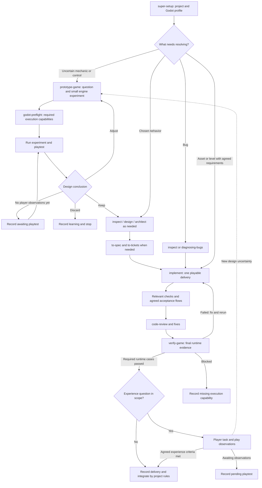

# Game development with Godot

Esquils keeps its shared design and delivery workflow and adds a Godot profile for playable experiments, engine execution and runtime acceptance. This profile currently targets Godot projects; it does not supply an engine, MCP server, testing framework, assets or desktop-control service.

The developer directs the game, creates/selects assets and evaluates play. Agents prepare experiments, implement agreed behavior, integrate assets and collect evidence with the tools actually available. Start with one small playable delivery and adjust the process from that experience.

## Install or update

The full Esquils installation includes the game skills and shared engineering skills:

```bash
npx skills add rondevz/esquils -g --skill '*' --agent claude-code codex opencode
```

That command installs the catalog published in the remote repository. To use changes from a local Esquils checkout before publishing them, run from that checkout:

```bash
python3 scripts/link-global-skills.py
```

The local linker preserves existing entries and reports conflicts. Rerun it when new skill directories are added. Existing links pick up file edits; open a new agent session if the catalog has not refreshed. Install/configure the chosen Godot version separately and provide its executable path when it is not discoverable.

## Two connected routes

Use an experiment when the gameplay choice is uncertain, and an implementation ticket when the behavior is chosen. Bugs, asset integration and tuning enter at the point that fits their uncertainty; every change does not need a new interview and spec.



This is a guided workflow, not a command that runs the entire diagram. `implement` already performs its agreed checks and review; a separate `verify-game` invocation can accept the reviewed result or an integrated journey. Reuse final-revision evidence and rerun affected cases after fixes. An unresolved experience result stays explicit even when objective runtime cases passed.

## Start in a project

Invoke skills in your agent's supported syntax; the following are ordinary-language prompts, so they also work without slash-command support.

**Configure once:**

> Use super-setup for this Godot project. Preserve the selected engine version and renderer. Record the project root, launch/reset commands, existing test and export recipes, and the capabilities available for runtime verification.

Setup keeps tracker/domain configuration and records the Godot profile in existing project guidance, or `docs/agents/godot.md` when no equivalent exists. It links that profile from the project's selected agent instruction file. Configuration records distinguish selected settings from capabilities actually verified. Setup does not create gameplay or install optional tooling.

**Check execution readiness when needed:**

> Use godot-preflight for the guard-distraction scene. We need headless rule checks and a rendered playtest with mouse capture; export is outside this check. Reuse the project's existing runner and reset recipe.

The result identifies which requested capabilities work and which need setup. A CLI, connected MCP or project harness can supply execution. Missing desktop automation does not make an independently executable rule test unavailable.

## Discover a mechanic

> Use prototype-game to explore whether holding the bow draw makes aiming more satisfying. Build a small target room, expose the charge curve, keep target placement fixed, and give me a short task to compare alternatives. Record technical results and my play observations separately.

The experiment produces a runnable scene/reset recipe and a concise question/result record. Keep, adjust and discard are useful conclusions. If the relevant playtest has not happened, the record says awaiting playtest rather than presenting a design verdict. Validated decisions feed later design/specs; the prototype does not become a production commitment automatically.

## Deliver chosen behavior

Use the shared `inspect`, design/architecture, `to-spec`, `to-tickets` and `implement` skills when appropriate. Work from the existing decisions rather than repeating all phases for every small change.

Make tickets describe a playable moment. For example:

> From cover, throwing a stone makes a guard investigate its impact, creating an opportunity to cross the doorway.

Carry a starting scene, positions/state, reset, actions, expected observations and verification method into that ticket. Separate objective criteria, such as investigation reaching the impact region without vision through walls, from the playtest question of whether the opportunity is understandable.

> Use implement for ticket 04, following the Godot execution profile. Preserve the agreed guard behavior and test scene. Use existing rule tests and engine checks; record any rendered or desktop-input coverage that could not run.

TDD remains useful for agreed rule interfaces: inventory, reward delivery, skill purchases and state transitions. A project-native scene harness can check physics/navigation integration. Camera comfort, timing perception and enjoyment need play observations. The workflow does not install a framework merely because the engine has no project test suite yet.

## Verify a scene or build

> Use verify-game for ticket 04 in the guard-distraction scene. Check impact noise, investigation, the occluded doorway route and reset. After the technical cases, give me the agreed player task to evaluate whether the guard's response is legible.

`verify-game` derives cases from the agreed contract, prepares isolated synthetic state, establishes needed readiness and records passed/failed/blocked runtime outcomes with evidence. It does not bypass the behavior under test by directly creating the successful result.

Use a headless run for what it can establish, a rendered run for appearance/motion, and desktop interaction for bindings/focus/mouse capture. Screenshots support visual claims; technical tests do not certify enjoyment. A successful export still needs target-runtime execution. Seeds and known starting states improve repeatability without guaranteeing deterministic physics.

Report implementation/review, automated checks, runtime acceptance, relevant playtest observations and integration independently. A pending playtest matters when that experience question is part of completion; it is not a universal human-approval gate for every code or asset change.

## Assets, levels and collaboration

An asset delivery can start from agreed requirements and use the implementation/verification route directly. Record origin/license and the relevant export/import contract: scale, orientation, materials, collision, animation names and shared skeleton where applicable. Keep source assets separate from generated imports and integrate gameplay through the project's inherited/wrapper-scene or import-customization conventions. Exercise reimport when the delivery depends on it.

For example, replacing a guard model should preserve the existing patrol scene's behavior and satisfy the chosen animation/collision requirements after re-export and reimport. It need not reopen the whole game architecture.

Give concurrent workers clear ownership of scenes, shared resources, rigs and binaries. Dependencies alone do not prevent conflicting edits to one level. Start with one delivery at a time; use agents in parallel only when the work and authorization support it.

## Skills and references

- [prototype-game](prototype-game/SKILL.md): a playable experiment and a design result.
- [godot-preflight](godot-preflight/SKILL.md): capability-specific engine readiness.
- [verify-game](verify-game/SKILL.md): runtime acceptance and distinct playtest observations.
- [Runtime reference](godot-preflight/references/runtime.md): execution semantics, scenario repeatability, assets and export, with official Godot sources.
- [Shared engineering skills](../engineering/README.md): design, tickets, implementation and review.
- [Web profile](../web/README.md): browser surfaces retain browser verification, including in a project that also has a game runtime.
